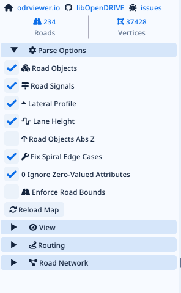

# Editor interface

## Direction

Clean light-mode engineering UI, following the supplied reference and Dear ImGui controls.
Use compact rows, restrained pale-blue sections, readable labels, and a dominant map viewport.

The image is a visual reference, not a requirement to copy its navigation, counters, or parser controls.
Use the [Dear ImGui demo](https://github.com/ocornut/imgui/blob/master/imgui_demo.cpp) for standard control behavior.

## Layout

| Area | Contents |
| --- | --- |
| Top menu | File, Edit, Add, View, Tools. Compact tool actions where needed. |
| Left panel | Search and hierarchical document tree; grouped roads, junctions, and other elements. |
| Center | Top-down and perspective viewport; selection and editing handles. |
| Right panel | Selected element's properties, child records, and references. |
| Bottom status | Selection/path, coordinates, active tool, concise diagnostic count. |
| Optional panels | Diagnostics, XML, and profile graph; opened when needed. |

- Resizable panes; one consistent panel treatment.
- Fixed/split panes first; docking is optional if it improves the actual workflow.
- No nested cards, decorative separators, dashboard tiles, marketing copy, or repeated help blurbs.
- Do not fill unused space with unrelated controls.

## Theme tokens

Starting values based on the supplied direction; adjust centrally after reviewing the running app.

| Token | Starting value |
| --- | --- |
| Window background | #F5F9FF |
| Section header | #D5E5FA |
| Input/button fill | #E9F1FB |
| Primary text | #182B45 |
| Secondary text | #596F91 |
| Accent and selection | #1683FF |
| Boundary line | #A7B4C7, used only where separation is needed |
| Base font | One embedded font, approximately 13 logical pixels |
| Control height | Approximately 24 logical pixels |
| Spacing | 4-pixel base unit; consistent 8-pixel panel padding |
| Rounding | Subtle, approximately 3 pixels |

- Scale dimensions consistently for DPI.
- Use one text font and one coherent icon set.
- Keep axis colors confined to standard 3D gizmos and their legend.
- Reserve error/warning colors for diagnostics; include an icon or text meaning.
- Viewport feature colors are semantic tokens, not arbitrary per-panel choices.
- Do not bundle unlicensed system fonts.

## Shared controls

| Control | Required behavior |
| --- | --- |
| PropertyRow | Consistent label/value alignment, unit display, keyboard focus. |
| OptionalProperty | Distinguish absent, empty, zero, and populated values. |
| NumberField | Typed numeric editing without silently changing unrelated values. |
| ReferencePicker | Search known targets; preserve typed values when explicitly editing raw XML. |
| RecordTable | Add/remove/reorder known repeated elements with consistent actions. |
| ElementTree | Stable NodeId selection; compact search and context menu. |
| DiagnosticRow | Short issue, affected element, select/focus action. |
| ProfileEditor | Shared graph interaction for width, offset, elevation, and banking. |
| ToolBar | Existing actions and shortcuts; no duplicate bespoke button styling. |

Compose panels from shared controls. Do not implement a new inline variation of an existing control.
Use native ImGui widgets unless a real missing interaction warrants a custom component.

## Text and feedback

- Labels identify the property; units sit beside values.
- Short tooltips only where terminology or behavior is unclear.
- No explanatory paragraphs inside panels.
- Successful edits are quiet; selection, values, and preview show the result.
- Diagnostics identify the problem directly: "Lane target missing" or "Curve fit failed".
- The diagnostics panel may expose technical details on demand.
- Normal corrections do not require repeated confirmation dialogs.
- Failed ambiguous corrections leave the command unapplied and point to the conflicting elements.
- Raw XML editing is explicit; its values do not undergo automatic semantic correction.

## Selection and input

- Picking selects the same NodeId used by the tree and inspector.
- Shift/Ctrl selection follows a consistent, documented convention.
- Frame selection, orbit, pan, and zoom have stable controls.
- Numeric entry and gizmo movement invoke the same edit command.
- Escape cancels an active gesture; release commits one undo entry.
- ImGui keyboard/mouse capture prevents viewport tools from activating behind panels.
- Delete acts on the focused selection; text-field deletion remains text editing.
- Unsupported or unrenderable elements stay accessible in the tree.

## Map tools

| Tool | Interaction |
| --- | --- |
| Add road | Select template/type, choose start, draw parameters, preview, commit. |
| Add lane | Select section and insertion side/position; automatic ID/reference remap. |
| Edit geometry | Numeric controls plus handles appropriate to that curve type. |
| Place object/signal | Pick road-relative position; adjust orientation and dimensions. |
| Edit outline | Add/move/remove corners; keep corner references consistent. |
| Connect | Choose explicit endpoints/lanes and create the selected relationship. |
| Attach geometry | Later: choose anchor/movable scope and alignment/fitting mode. |

The viewport is useful for geometry. Metadata and relationship records remain compact forms/tables.

## Visual acceptance

- Compare the running UI with the supplied reference at normal and high DPI.
- Inspect light theme, row alignment, density, selected state, disabled state, and keyboard focus.
- Inspect a small file, a large tree, a long property value, and a diagnostics-heavy file.
- Verify no panel introduces its own spacing, typography, or colors.
- Store temporary screenshots under repository-root `.codex/`.
